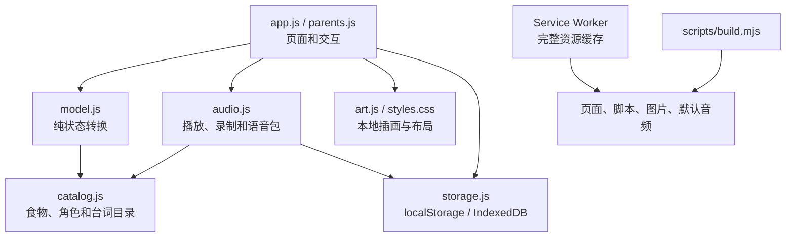

# 技术架构

## 当前架构是一个无后端的本地优先PWA

浏览器加载静态HTML、CSS、JavaScript、SVG和音频。游戏规则由纯状态模型处理，DOM只负责呈现和把儿童操作转换为动作。Service Worker缓存完整资源，使安装到桌面的入口可以离线启动。



应用没有第三方运行时依赖，没有业务API，也不需要账号。

## 模块职责保持清楚

| 文件 | 职责 |
| --- | --- |
| `public/js/catalog.js` | 食物、量词、角色、默认设置、全部台词ID和音频路径 |
| `public/js/model.js` | 创建会话、生成订单、取放、计数、判断、轮次、计时和旧存档迁移 |
| `public/js/app.js` | 儿童页面、事件分发、拖动、暂停恢复和模型渲染 |
| `public/js/art.js` | 动物、食物和通用图标的内联SVG |
| `public/js/parents.js` | 家长设置、逐句录音、试听、导入导出和离线管理界面 |
| `public/js/audio.js` | 串行播放、麦克风录制、PCM WAV转换、语音包校验 |
| `public/js/storage.js` | 设置和会话的localStorage封装、录音的IndexedDB事务 |
| `public/js/offline.js` | Service Worker注册、完整性检查、修复和显式更新 |
| `scripts/sw-template.js` | 构建时使用的Service Worker模板 |
| `scripts/build.mjs` | 复制发布资源、生成清单版本和Service Worker |

新增规则优先写进 `model.js`，并通过动作驱动，不要在DOM事件中维护第二份游戏状态。

## 状态模型维护数量守恒

每个食物对象都有稳定的 `id` 和 `food`。`stock` 表示一轮中存在的全部食物，`plate` 表示已装盘的子集；锅中内容由二者的差集得到。取放改变位置，不创建或复制食物。

主要不变量：

- 点餐模式库存全部是目标食物；`settings.supply=exact` 时等于订单数量，`extra` 时目标为1～3、库存多一个。
- 分类和自由厨房每轮只选三种食物，每种两个。
- 一个物体不能同时出现在锅和盘子，也不能重复出现在盘子。
- 盘子最多五个食物。
- 每个盘内物体在一次计数状态中最多计数一次。
- `finished` 会话不能再响应儿童操作。

保存会话时包含订单、物体身份、盘子、计数标记、轮次和已用时。恢复旧会话要做结构校验；不合法数据应放弃恢复，而不是部分信任。

## 上菜核对阶段与异步完成

会话版本2增加 `flowId`、`review`、`warningPending` 和备菜设置。点餐从 `active` 进入 `reviewing`，依次经过引导、逐物数词、总量、目标与调整反馈／感谢，随后返回装盘或进入 `serving`。`review` 记录自动／手动、步骤、失败和无声模式，`counted` 保存本遍计数物体。DOM不另存计数结果。

界面每次只播放模型指定的一步，完成或失败携带 `flowId` 回传；取消、切换、重试、暂停和阶段推进使旧标识失效。享用计时和跳过还携带轮次，避免重复推进。核对时禁用重听，收工提醒延迟；时间上限优先收尾。音频失败可重试同一步或无声继续，已接受的标记不增加第二次。

v1恢复时补为准确份数档位并升级v2；v2验证库存、物体身份、计数标记和核对字段。恢复均先暂停：核对主动继续时重数；已提交的享用阶段不重新核对。语音包格式仍为v1，旧台词ID保留，新引导句缺少家人录音时用内置音频。

## 音频播放授权

角色语音使用复用的 `HTMLAudioElement`，取放提示音使用 `AudioContext`。开始、继续和声音恢复时，在同一次点击处理内直接调用语音播放器的 `play()`，同时尝试恢复音效引擎，不等待 `resume()` 的异步结果。音效引擎不可用不阻断角色语音；每次主动恢复都重新解锁，避免依赖中断前的授权。解锁使用与正常播放相同的取消标识，迟到的完成不能暂停新的语音。

自动化以受限点击授权模拟验证调用顺序；具体 iPadOS 版本上的授权、锁屏中断和扬声器输出仍须真机验收。

## 数据按用途分开保存

| 数据 | 存储 | 清除后的影响 |
| --- | --- | --- |
| 游戏设置、当前会话、最近摘要 | `localStorage`，前缀 `little-kitchen:` | 恢复默认设置，当前游戏和摘要丢失 |
| 家人录音 | IndexedDB `little-kitchen-voices/clips`，WAV 字节以 `ArrayBuffer` 保存 | 家人配音丢失，可从语音包恢复 |
| 页面和默认资源 | Cache Storage | 需要联网重新准备离线资源 |

浏览器、添加到桌面的PWA入口以及不同浏览器可能使用不同存储空间。任何功能都不能承诺浏览器数据永久存在。

## 语音包是当前的跨设备边界

每条录音以 `角色/台词ID` 为键，保存为22.05kHz、单声道、16位PCM WAV。导出文件结构为：

```json
{
  "format": "little-kitchen-voices",
  "version": 1,
  "exportedAt": "ISO-8601 时间",
  "clips": [
    {
      "key": "rabbit/order-dumpling-3",
      "mime": "audio/wav",
      "data": "base64 音频"
    }
  ]
}
```

导入必须先检查格式、版本、台词ID、重复键、MIME、文件大小和浏览器可解码性。文件选择器返回后不再尝试播放或解锁声音：iPad Safari 此时已失去用户手势授权，校验改用不输出声音的 `OfflineAudioContext` 解码。全部通过后再请家长确认；所有 WAV `Blob` 在事务开始前转换为 `ArrayBuffer`，避免部分 iPad Safari 拒绝在 IndexedDB 中直接保存 Blob。随后用一次 IndexedDB 事务提交，失败时保留原录音。读取时恢复为 `audio/wav` Blob，并兼容旧版本已保存的 Blob 记录。

游戏内录音不进入构建产物、不上传服务器，也不提交Git。独立语音制作工具的云端数据边界见下一节；不能把游戏“只在本机”的说明用于远程合成阶段。

## 独立本机语音包制作工具

`scripts/generate-voice-pack.mjs` 提供 plan / sample / generate / pack。`scripts/voice-pack/core.mjs` 复用当前台词、配置与 WAV/v1 包校验；`volcengine.mjs` 负责官方 HTTPS 合成与完整流校验；`runner.mjs` 负责顺序执行、摘要缓存、原子保存与本地试听页。

音色 profile 与游戏角色分离。环境文件提供实际 Speaker ID 和凭据；指纹包含实际音色值、台词文本、模型、语速、资源及音频格式，缓存还校验音频 SHA-256。切换音色或修改文本不能复用旧结果；同槽位云端重新训练需显式重做。服务未成功结束、全静音、损坏或超过单句 15 秒时不缓存。失败停止，不自动重复付费调用；已完成句子可恢复复用。

公开台词和已有音色 ID 发往火山引擎，音频返回本机 `.voice-packs/`；不上传训练样本、儿童信息或浏览器数据。该目录及凭据被 Git 忽略，不被构建和本地游戏服务器提供。试听页包含私人音频，和缓存/备份一起按需清理。云端音色及训练材料由本人在控制台单独管理，工具不代为训练或删除。

`pack --reviewed` 仅在成人试听确认后离线生成现有 v1 格式。默认要求全部当前台词，显式 `--lines` 支持部分包。游戏仍先完整验证、家长确认，再在单次 IndexedDB 事务中按角色/台词覆盖，其他录音保留。使用和测试见 [VOICE_PACKS.md](./VOICE_PACKS.md)。

## 离线更新使用完整资源快照

构建脚本为全部静态文件生成内容版本和资源清单。Service Worker先把新版本下载到临时缓存，确认所有资源存在后才提交；失败时删除临时缓存并继续保留旧版本。游戏中不自动刷新，更新入口只出现在首页或家长区。

Cloudflare Pages会把 `/index.html` 重定向到 `/`。缓存导航响应时需要保存普通响应，避免旧版Chrome在读取带重定向标记的缓存时出现 `ERR_FAILED`。相关回归测试在 `tests/deployment.mjs`。

## 修改后按影响范围验证

```bash
npm test
npm run build
```

改变DOM、触控、录音或离线流程时，在本地服务运行期间执行：

```bash
npm start
npm run test:browser
npm run test:serving
```

改变Service Worker或部署行为时再执行：

```bash
npm run test:deployment
```

自动化测试不能替代iPad Safari和Android Chrome真机验收。真实麦克风、桌面安装、断网冷启动、横竖屏和双设备语音包转移都要按 [验收记录](./ACCEPTANCE.md) 检查。
