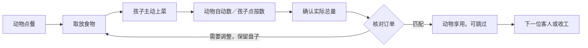

# 产品与交互设计

## 2026-10-11 第二轮视觉调整

家长标签使用浅色分段导航：选中项为奶油白底、叶绿色文字和细边框，清除旧样式的绿色底线与黄色按钮厚阴影。导航选中态不使用操作按钮的立体材质；键盘焦点仍有独立的可见轮廓。

儿童主操作继续使用蜂蜜黄，次操作使用奶油白；边框减薄、硬底边改为浅柔阴影，按下仅下移1px。核心触摸目标仍至少72×72 CSS像素。厨房外框、餐具阴影、木纹与家长表单同步降低装饰对比，食物轮廓、计数序号和当前计数提示保持可辨认。

本轮仅调整样式，不改变玩法、音频、数量或存储规则。对比册保存上一轮新版、最初旧版与本轮优化版的同场景截图。

## 2026-10-11 绘本视觉升级

本次参考用户提供的九张设计规范图，统一为二维绘本厨房。第4张确定角色与食物方向，第5张确定按钮和组件方向，第9张确定厨房与响应式方向；第7张的黏土3D仅参考暂停和收尾的结构，不混用角色材质。

色板为奶油白 `#FFF8EC`、浅薄荷绿 `#E5F0E2`、森林绿 `#35624A`、叶绿 `#6F9473`、蜂蜜黄 `#F2C76C`、浅木色 `#DDB58C` 和珊瑚橘 `#E9A17F`。主动作采用蜂蜜黄色立体按钮，次动作采用奶油白按钮；声音与暂停为圆形按钮。角色与七种食物使用原生SVG，独立渐变表达柔和材质，同食物在全部容器中使用一致图案。

首页、厨房、享用和收尾使用统一薄荷绿墙面、暖色窗帘、陶瓷器皿与浅木餐桌。环境中的装饰不使用可计数食物。家长区采用奶油色面板和清晰表单，保留设置、逐句录音、导入确认与离线更新。

分类盘的食物目标在盘沿独立标牌中展示，与已分类实物区分。窄屏锅与盘上下排列，核心食物和按钮仍至少72×72 CSS像素。所有界面保留数量守恒、点击路径、主动上菜、计数标记、声音恢复、无声继续和自然收尾；减少动态效果设置继续生效。

图片完整性核对：01视觉方向→附件1；02基础规范→附件3；03角色食物→附件4；04组件→附件5；05首页点餐→附件2；06核对→附件6；07分类自由厨房→缺失；08暂停收尾→附件7；09家长区→附件8；10响应式→附件9。缺失的分类和自由厨房界面按既有模式规则与统一组件实现，不引入额外玩法。

参考图不作为功能需求：修正图中混合点餐、同时接待两个客人、取走后锅仍满、麦克风“帮我数”、儿童重置按钮、无限制时长、关闭图案提示、录音全部与整体数据备份等与现有边界不一致的表达。儿童端不出现麦克风入口。

实现入口：`public/storybook.css`、`public/assets/kitchen-wall.svg` 和 `public/js/art.js`。源文件可编辑且无需远程图片；新增资源随离线构建加入清单。

## 让孩子先理解“我要做什么”

儿童端用动物、食物图案、数字和语音共同表达任务。文字主要帮助照护者，不应成为孩子完成游戏的前提。每个页面只突出一个主要动作，反馈一次只处理一个问题。

设计优先级依次是：

1. 看得懂食物和目标。
2. 点得到、拿得回、改得了。
3. 听得清订单和反馈。
4. 能把数字、实际物体和数数联系起来。
5. 愿意继续尝试，也能平静结束。

## 儿童端保持一条短流程

数量凑齐时不自动提交。孩子点击“上菜”后，游戏开始核对实际盘子，数完再反馈。错误不会清空盘子，也不会移动食物代替孩子完成。

## 三种模式承担不同任务

| 模式 | 孩子正在做什么 | 画面中的食物 |
| --- | --- | --- |
| 动物点餐 | 按种类和数量准备一份订单 | 只出现目标食物；一起装盘等量，自己拿够多一份（目标1～3） |
| 食物分类 | 把相同食物放到对应图案的盘子 | 每轮三种，每种两个，共六个 |
| 自由厨房 | 自由搭配、请动物吃饭，也可以数数 | 每轮三种，每种两个，盘子最多五个 |

点餐余量只增加相同种类的食物，不加入其他干扰种类。需要练习种类区分时，使用分类模式。

## 上菜前的数一数是可选择的帮助

进入计数状态后，盘内物体暂时不能移动。孩子每点一个尚未数过的食物，界面留下序号标记并播放下一个数词；重复点击同一物体不重复计数。全部点完后说出总量。

退出计数状态后可以继续取放。盘子发生变化时，旧计数标记清除。数数不替孩子判断订单，也不要求每轮都使用。

## 上菜后的核对与享用

默认动物按盘内顺序逐个指物数，保持位置稳定，用指针、轮廓和序号共同标记，数完突出整盘总量。“我来数”使用小手图案和语音引导；手动模式的“帮我数”使用当前动物图案。切换清空标记从一重数，手动模式等待孩子操作，不催促或自动接管。

当前数词播放时不接收下一件的计数，播完后继续；已数过物体不能再次计数。孩子可随时“继续装盘”，取消本次核对再调整。失败时提供“恢复声音”和“无声继续”，不强制听完才能退出。

实际总量确认后才反馈订单。匹配后盘子送到动物面前，食物逐个移向嘴边，动物咀嚼并感谢。约3.6秒，可跳过；减少动态效果时静态展示。吃东西期间不再报递增数词，避免把正在减少的数量当作原总量。该流程用于动物点餐。

## 反馈只告诉孩子下一步能做什么

| 情况 | 反馈重点 |
| --- | --- |
| 食物种类不符 | 突出订单食物：“看看，我想吃的是……” |
| 数量少 | 提醒还少一点，并邀请一起数数 |
| 数量多 | 提醒可以拿回去再看看 |
| 连续两次未匹配 | 临时展开完整份数图案，便于一一比较 |
| 分类放错 | 食物留在原处，提醒看盘子图案 |
| 没有操作 | 安静等待，不催促、不倒数 |

不使用红叉、失败音效、扣分、动物生气或连续奖励。游戏记录只帮助家长了解本次体验，不显示能力结论。

## 食物插画以幼儿辨认为标准

每种食物使用独立轮廓、结构线索和颜色组合，不能只靠颜色区分。图案在锅、盘、订单和分类目标中使用同一套画法。

| 食物 | 主要辨认线索 |
| --- | --- |
| 水饺 | 半月形、鼓起的肚子和清楚的褶边 |
| 大虾 | 弯曲身体、头和眼睛、长触须、分节和尾部 |
| 排骨 | 一块肉、肉的纹理、仅从两侧露出一点的短白骨头 |
| 西蓝花 | 多个绿色花球和粗短菜梗 |
| 青菜 | 向外展开的叶片和浅色菜帮 |
| 香菇 | 宽伞盖、菌褶和短柄 |
| 包子 | 圆鼓外形和顶部收拢褶纹 |

修改食物图案时，至少在实际游戏尺寸下检查：缩小后轮廓是否仍清楚、同屏食物是否容易混淆、孩子是否需要文字才能猜到。幼儿试用反馈优先于成人对画面精致度的偏好。

## 触控适合尚不精确的小手

- 核心按钮和食物触摸区域至少为72×72 CSS像素。
- 点击是完整操作路径，拖动只作为补充。
- 一次操作只移动一个有固定身份的食物，单个指针生效。
- 靠近有效盘子时吸附，落在无效区域时回到原位。
- 不要求双指、长距离精确拖动、快速连续点击或阅读长文字。
- 横屏是主要布局，竖屏上下排列；旋转后保持当前订单和盘子。

## 声音保持温和、短而完整

小兔子和小熊轮流说话。家人录音是在扮演角色，可以由妈妈、爸爸或其他家人自由分配，不绑定角色性别。

- 一条录音是一句完整台词，最长15秒。
- 订单先说动作、数量和食物，例如“我想吃三只虾”。
- 上菜前可选数数及上菜后手动核对按孩子点按节奏逐个播放；自动核对每个数词结束后才指向下一件，数完确认总量。
- 语音串行播放；切换订单、退出或进入后台时停止旧语音。
- 默认无背景音乐，避免与语言争夺注意力。
- 未录制条目立即使用默认语音，不让不完整的语音包阻断游戏。

已获本人授权的复刻声音可以通过独立电脑工具制作语音包，沿用完整短句和现有家长导入流程。成人先检查数字、量词、食物名和整句效果，再用于动物角色；小兔子和小熊可使用不同家人的音色。生成和云端配置不出现在儿童端。制作步骤见 [语音包制作说明](./VOICE_PACKS.md)。

## 家长区负责准备，不侵入儿童流程

家长入口需要长按3秒再确认，用于防止孩子误触。家长可以设置下一局玩法、管理配音和备份、检查离线资源、跳过或提前收工。设置从下一次开局生效，避免正在玩的画面突然变化。

录音流程为：选择角色和台词 → 开始录音 → 停止 → 试听 → 保存或重录。麦克风只在主动录音时启用，取消、离开或切后台立即释放。

## 收尾比无限续玩更重要

点餐和分类最多三轮，默认每次五分钟。剩余约一分钟时只给温和语音提示，不显示儿童倒计时。达到轮数或时间后进入收尾页，不自动开始下一局，也不要求做对才能结束。

时间到时保留未完成的盘子，并说“今天先做到这里”，不能把未完成订单描述成成功。
